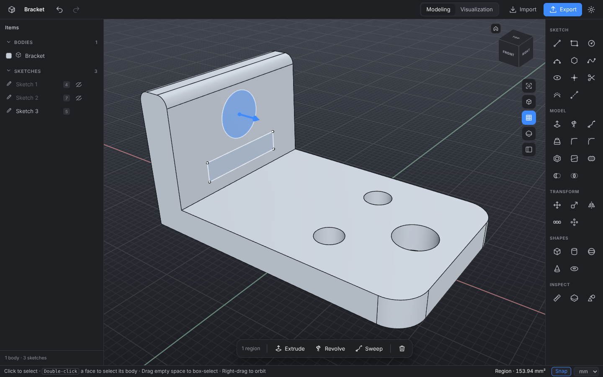

# ShaperBuild

A desktop 3D CAD app for Windows, macOS and Linux, modelled on the way Shapr3D works: sketch on any flat surface, pull shapes into 3D, round and combine them, and export for 3D printing or other CAD tools. It opens and edits **STL** files too.



## Download

Installers are built automatically by GitHub Actions:

- Open the **Actions** tab → latest **Build** run → **Artifacts**, and download the one for your system:
  - **Windows:** `ShaperBuild-Setup-x.y.z.exe`
  - **macOS:** `ShaperBuild-x.y.z-arm64.dmg` (Apple Silicon) or `-x64.dmg` (Intel)
  - **Linux:** `.AppImage` or `.deb`
- Tagged versions (`v1.0.0` …) also appear on the **Releases** page.

The installers are not code-signed yet, so the first launch shows a warning:
- **Windows:** "Windows protected your PC" → *More info* → *Run anyway*.
- **macOS:** right-click the app → *Open* → *Open*.

## 3D printing

Click **3D Print** (Ctrl+P / ⌘P). ShaperBuild checks your design before you print:

- every body is a **closed, solid shape** (no holes in the surface),
- it **fits your printer's bed** (Prusa, Bambu Lab and Creality presets, or your own size),
- it isn't tiny or huge by mistake, and whether bodies overlap.

It shows the size, volume and roughly how much plastic it takes. Then save a **3MF** (recommended) or **STL** file — placed on the bed, one file or one per body — or click **Open in** to send it straight to PrusaSlicer, Bambu Studio, OrcaSlicer, UltiMaker Cura or Creality Print if one is installed.

## Getting started

The first time you open ShaperBuild it asks for your language: **English** or **Norwegian (bokmål)**. Everything follows the choice — tools, hints, menus, messages, file dialogs and drawings, with decimal commas in Norwegian (typing `12,5` or `12.5` both work). Change it later under **Settings → Language**; the window restarts and your open design stays as it was.

Then it offers an **interactive tutorial** (about 3 minutes). It shows you how to move around, draw a rectangle, pull it into 3D and round its edges, and it waits for you to try each step. You can start it again any time from **Help → Interactive tutorial** or the home screen.

Finding your way around:

- **Tools** are on the right, with names, grouped into Sketch, Model, Transform, Shapes and Inspect. Hover one to see what it does.
- **Search tools** (Ctrl+K / ⌘K) finds any tool or command by name or purpose — try "hole", "round" or "print".
- **Items** on the left lists everything in your design: bodies, meshes, sketches, planes and images. Hide, rename, recolour or delete them there, and sort them into **folders** — folders can hold other folders (the folder button at the top, or drag items and folders onto a folder).
- **History** (the tab next to Items, or Shift+H) lists every step that made your design, in order. Click a step to change it.
- The **bar at the bottom** suggests tools for whatever you selected. While a tool is active, a hint there tells you what to do next.
- The **buttons under the view cube** fit the view, jump to standard views, zoom, and switch on **Orbit** or **Pan** mode for dragging with the left button. The **mouse** button explains every way to move around.

## What it does

**Sketch** – Line, Rectangle (corner, centre or 3 points), Circle, Arc, Polygon, Spline (through points or shaped by control points), Ellipse, **Text**, Point, Trim, Offset, Pattern (rows, grids or around a point), Project and Construction lines. Click the grid, any flat face, a reference plane, a picture or an existing sketch to draw on it. Points snap to ends, midpoints, centers, body corners, alignments and the grid. Start typing while drawing to enter exact sizes (Tab moves between boxes, Enter applies). Closed shapes turn into regions you can click.

**Text** – Type a name or label, pick Bold, Regular or any font file, set the letter height and click where it goes. The letters come out selected, so pressing E raises them (or a negative height engraves them).

**Planes, axes and pictures** – The **Plane** tool adds a flat surface to draw on: at a distance from or tilted to the grid, a face or another plane, halfway between two faces, through three points, across a curve, through a line at an angle, or parallel to a face through a point. The **Axis** tool adds a reference axis (through two points, where two planes meet, through a round face, along an edge, or standing on a face) to revolve or turn things around. **Import** a PNG or JPG to trace over: type its real width, make it more or less see-through, and draw on it.

**Constraints and dimensions** – Sizes you type become dimensions you can click and change later; the sketch follows. Curves the constraints hold completely in place turn green. Lines drawn level or upright stay that way, and rectangles stay rectangles when you drag them. Select curves or points and use **Constrain** for parallel, perpendicular, equal, tangent, concentric, midpoint, on-curve, coincident, symmetric, lock/unlock, disconnect, angle and distance. The **Dimension** tool (D) adds lengths, diameters, radii and distances.

**Model** – Extrude (also push/pull of faces: grow a body or cut into it), Revolve, Sweep (with **twist** and a different **size at the end**, for twisted vases, screws and tapers), Loft, Fillet, Chamfer, Shell, Draft, Split, Union, Subtract and Intersect. Every tool shows a live preview before you apply it. Select a region or face and drag its blue arrow to extrude directly.

**Wrap & Emboss** – Put text or a logo on a part: pick the sketch shapes and a face, and raise or engrave them. It works on flat faces, round ones (a cup, a can, a handle — outside or inside), balls, cones, rings and free-form surfaces. On round faces the shapes are rolled on without stretching; on balls and other curved faces they keep their size where the sketch faces the surface and bend with it further out.

**Editable history** – Every step is remembered: extrude, fillet, shell, sweep, emboss, move, scale, mirror, split, draft, pattern, shapes and more. Open **History**, click a step and type a new value (say, make the first extrude taller, move a part further, or shift a cut): every later step is redone on top of it, so fillets, holes and push/pulls follow. Changing a sketch (a dimension, a curve, even trimming or redrawing a line) updates the bodies made from it, and sketches drawn on a face move with that face. Mirror, Split and Draft planes taken from a face follow that face. Steps can be turned off or deleted; if a later step no longer fits (a fillet that has become too big), it is marked in red and skipped until you fix it.

**Variables and formulas** – Any number field takes a formula: `20 + 5`, `1in + 2mm`, `1' 6"`, `width / 2`, `max(a, b)`, `sin(30)`… Add variables (lengths, angles or plain numbers) at the top of the History tab and use their names anywhere. Values typed with a variable stay linked: change the variable and every size made from it updates, including sketch dimensions (marked ƒ). Renaming a variable updates every formula. Number fields also have − / + buttons, and you can drag a field's name left or right to change it.

**Transform** – Move/Rotate with a gizmo or exact values, Translate (from one point to another), Rotate around an axis, Align (put a face, edge or corner onto another), Scale (uniform, or X/Y/Z separately for meshes), Mirror, Linear patterns in up to three directions, Circular patterns, Duplicate.

**Shapes** – Box, Cylinder, Sphere, Cone and Torus, placed by clicking.

**Inspect** – Measure lengths, areas, volumes, distances and angles; Section view with solid cut faces; X-ray (see-through bodies, Shift+X).

**Visualization** – Soft shadows and materials (plastic, matte, glossy, rubber, metal, brushed metal, chrome, glass) with any colour; save a PNG image.

**2D drawings** – Front, top and side views with hidden lines dashed, overall sizes, an optional 3D view and a title block, in 1st-angle (Europe) or 3rd-angle (USA) layout on A4, A3 or Letter. Save as PDF, SVG or DXF.

**STL and mesh files** – Import STL (binary or text), OBJ and 3MF. Meshes can be moved, scaled, mirrored, patterned and combined with solids (union / subtract / intersect). *Mesh → Solid* turns a mesh into an editable solid, merging flat triangles into real faces so you can push/pull and fillet them.

**Files** – Save designs as `.shaperbuild`. Export STL, 3MF, OBJ, STEP, DXF (sketches, for laser cutters) and PNG images. Import STEP, DXF (becomes a sketch) and pictures. Autosave with crash recovery. Drag and drop files onto the window. Unlimited undo/redo.

The geometry engine is [OpenCascade](https://dev.opencascade.org/) (a real B-rep CAD kernel, through `replicad-opencascadejs`), with [Manifold](https://github.com/elalish/manifold) for mesh booleans.

## Selecting

- Click selects a face, edge, curve or region; double-click selects the whole body. The **filter** in the status bar limits clicks to bodies, faces or edges.
- Drag a box over empty space: **left to right** selects what is fully inside, **right to left** (dashed green) selects everything the box touches.
- Right-click → **Select through…** lists every face under the pointer, also the ones hidden behind others.
- The menu next to **Snap** chooses what to snap to (endpoints, midpoints, centres, intersections, body corners, curves, guides, grid). Click the **grid size** in the status bar to lock it.

## Mouse and keys

| | |
|---|---|
| Orbit | Right-drag · hold Space and drag · arrow keys (trackpad: two-finger swipe) |
| Pan | Middle-drag or Shift + right-drag · Shift + Space and drag · Shift + arrow keys |
| Zoom | Scroll wheel or pinch · + and − |
| Select | Click (adds to the selection) · double-click a face for its whole body · drag on empty space for a box |
| Standard views | View cube, keys 0 (iso), 1 (front), 3 (right), 7 (top), or Ctrl+1–7 (reset, front, back, top, bottom, right, left) |
| Look at a face | Tap Space with the pointer over it |
| Zoom to fit | Z |
| Tools | L line · R rectangle · C circle · A arc · P polygon · B spline · T trim · D dimension · E extrude · Q revolve · F fillet · H shell · U union · M move · K measure · X section |
| Undo / redo | Ctrl+Z / Ctrl+Y (⌘ on Mac) |
| Find a tool | Ctrl+K (⌘K on Mac) |
| Design history | Shift+H |

| Constraints | Shift+A parallel · Shift+P perpendicular · Shift+V horizontal/vertical · Shift+E equal · Shift+T tangent · Shift+C concentric · Shift+N coincident · Shift+M midpoint · Shift+L lock |

Press **?** or use *Help → Keyboard Shortcuts* in the app to see everything. **Settings → Keyboard shortcuts** switches to a Shapr3D-style set of keys (V revolve, W sweep, I spline, G polygon, X search, Tab selection filter…) and lets you change any key, or edit them all as JSON. See [DECISIONS.md](DECISIONS.md) for how conflicts are handled. Laptop without a mouse? Use the Orbit and Pan buttons, or set *Settings → Scroll wheel / two-finger swipe* to orbit.

## How it compares to Shapr3D

It follows Shapr3D's workflow and layout closely, but it is not a copy of Shapr3D and does not have everything yet. Not included so far: IGES files, AI rendering, the iPad / Vision Pro / AR apps, cloud sync and team sharing, and the video learning center.

## Updates

The installed app checks GitHub for new versions. On Windows and Linux it downloads them in the background and shows **Restart to update** in the top bar; on macOS it shows a **Download** button (the Mac build is not code-signed, which macOS needs for self-updating). Turn checks off in Settings, or use *Help → Check for Updates…*.

To publish a new version, push a tag like `v1.2.0` (or create a release with that tag on GitHub). CI builds the installers, uses the tag as the version, and attaches the files the updater needs.

## Run from source

Needs [Node.js](https://nodejs.org/) 20 or newer.

```
npm install
npm start
```

| Command | What it does |
|---|---|
| `npm test` | Unit tests and geometry kernel tests (runs OpenCascade in Node) |
| `npm run test:e2e` | Drives the real app through sketching, modelling, STL import, save/open and export. On Linux run it with `xvfb-run -a`. Screenshots go to `test-output/`. |
| `npm run dist` | Builds an installer for your system into `dist/` |
| `npm run vendor` | Refreshes the files copied into `src/vendor/` after upgrading three or manifold-3d |
| `node tools/i18n-extract.mjs` | Lists English text that has no Norwegian translation yet |

**Translations.** Write text in the code in English; it is looked up in `src/i18n/nb.js` when shown. `npm test` fails while any text is missing a Norwegian translation or a translation drops a `{placeholder}`.

## Project layout

```
electron/        main process: window, native menu, file dialogs, app:// protocol
src/
  app.js         app controller: document, selection, snapping, previews, shortcuts
  commands.js    document changes (apply kernel results, delete, duplicate, …)
  fileops.js     open / save / import / export
  core/          pure logic: units & expressions, 2D geometry, constraint solver, planes, document + undo, file formats, languages
  i18n/          translations (nb.js: Norwegian bokmål; electron/i18n.cjs has the native menus)
  kernel/        geometry kernel (OpenCascade + Manifold) running in a Web Worker
  view/          three.js viewport: camera, grid, view cube, GPU picking, bodies, sketches, overlays
  tools/         interactive tools (select, sketch, modelling, transform, measure, section)
  ui/            panels: items, tools menu, tool options, context bar, dialogs, home screen
tests/           unit, kernel and end-to-end tests
tools/           helper scripts (i18n-extract.mjs lists text that still needs a translation)
build/           app icon
```

## Third-party software

OpenCascade via replicad-opencascadejs (LGPL-2.1), Manifold (Apache-2.0), three.js (MIT) and Electron (MIT).
